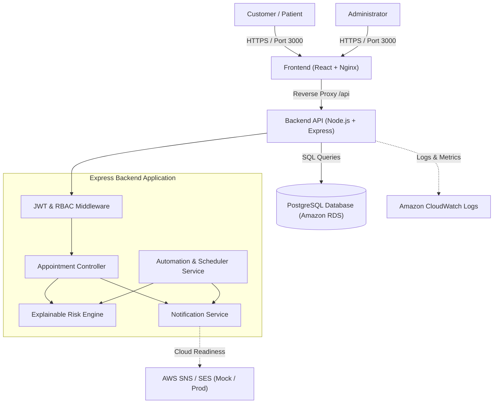
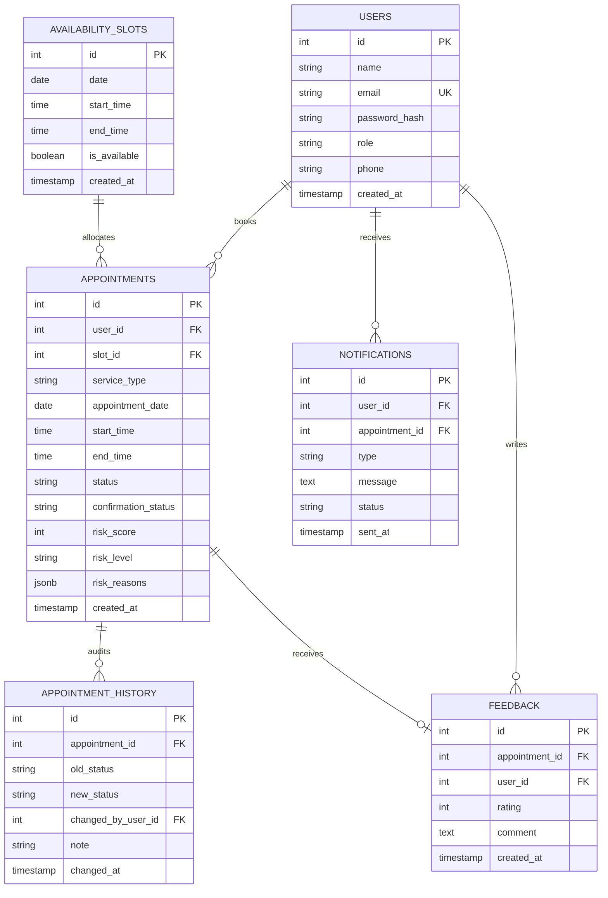
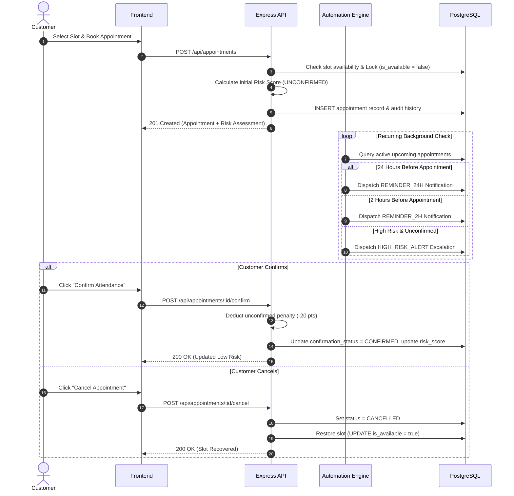

# System Architecture & Technical Design

**Project:** Smart Appointment Optimization & No-Show Prevention Platform  
**Author:** Adarsh Paul . T (24MIS0564)  
**Course:** Agile Development Process and DevOps  

---

## 1. High-Level Architecture Overview

The system follows a modern decoupled 3-tier cloud-ready web architecture:
1. **Client Tier:** React.js Single Page Application (SPA) served via Nginx.
2. **Application Tier:** Node.js + Express.js REST API with layered Controller-Service architecture.
3. **Data Tier:** Normalized PostgreSQL Relational Database (Amazon RDS / Docker).

---

## 2. Component Design & Layering

### 2.1 Frontend Architecture (React)
- **Framework:** React 18 with Vite build tooling for fast HMR and optimized production bundles.
- **State Management:** React Context API (`AuthContext`) managing user session tokens and live state.
- **Routing & Views:** Modular views (`LandingPage`, `CustomerDashboard`, `AdminDashboard`, `AuthModal`).
- **Design System:** Pure modern CSS custom properties with responsive flexbox/grid layout and distinct status/risk badges:
  - `badge-low`: Emerald green (`#10b981`)
  - `badge-medium`: Amber yellow (`#f59e0b`)
  - `badge-high`: Crimson red (`#ef4444`)

### 2.2 Backend Architecture (Node.js & Express)
The backend follows strict separation of concerns:
- **Routes (`src/routes/`):** Pure URL routing and middleware registration.
- **Controllers (`src/controllers/`):** HTTP request validation, parameter parsing, and response status formulation.
- **Services (`src/services/`):** Business logic encapsulation:
  - `RiskService`: Pure mathematical and heuristic rule evaluation.
  - `AutomationService`: Background scheduled tasks and interval checks.
  - `NotificationService`: Channel abstraction (In-App, Mock Console, AWS SNS/SES).
- **Database Abstraction (`src/db/`):** Resilient dual-mode database connector. Connects to PostgreSQL when present, and seamlessly activates a transactional in-memory store for local zero-dependency testing.
- **Middleware (`src/middleware/`):** JWT verification, admin access control, and CloudWatch-compatible structured request logging.

---

## 3. Database Schema (Normalized PostgreSQL)

---

## 4. Explainable Rule-Based Risk Engine Architecture

The risk scoring model evaluates four transparent operational factors to produce a score between 0 and 100:

$$\text{Risk Score} = \min(100, P_{\text{no-shows}} + P_{\text{cancellations}} + P_{\text{confirmation}} + P_{\text{attendance}})$$

### Factor Breakdown:
1. **Previous No-Shows:**
   - 0 past no-shows: $+0$ points
   - 1 past no-show: $+20$ points
   - 2 past no-shows: $+35$ points
   - 3 or more past no-shows: $+45$ points
2. **Previous Cancellations:**
   - 0 past cancellations: $+0$ points
   - 1–2 past cancellations: $+10$ points
   - 3 or more past cancellations: $+15$ points
3. **Current Confirmation Status:**
   - `CONFIRMED`: $+0$ points
   - `UNCONFIRMED`: $+20$ points
4. **Historical Attendance Rate:**
   - $\ge 90\%$: $+0$ points
   - $70\% - 89\%$: $+10$ points
   - $< 70\%$: $+20$ points

### Risk Level Bands:
- **0 – 30:** `LOW RISK` (Green)
- **31 – 60:** `MEDIUM RISK` (Amber/Orange)
- **61 – 100:** `HIGH RISK` (Red)

Each factor that adds penalty points appends an explicit, human-readable reason string (e.g., *"2 past no-shows on record"*, *"Current appointment is not yet confirmed by customer"*), ensuring total transparency for administrators.

---

## 5. Automation Architecture & Lifecycle

