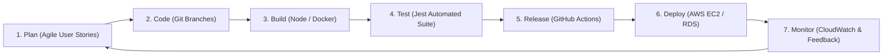

# DevOps Practices & Continuous Integration / Continuous Deployment (CI/CD)

**Project:** Smart Appointment Optimization & No-Show Prevention Platform  
**Author:** Adarsh Paul . T (24MIS0564)  
**Subject:** Agile Development Process and DevOps  

---

## 1. DevOps Lifecycle Integration

DevOps bridges the gap between software development and IT operations to deliver frequent, reliable releases with continuous quality assurance:



---

## 2. Git Branching Strategy

The repository follows a streamlined Git flow:
- `main`: Production-ready branch. Direct pushes are protected; code is merged only via pull requests that pass all CI quality gates.
- `feature/<name>`: Dedicated branches for developing discrete user stories (e.g., `feature/risk-engine`, `feature/slot-recovery`).
- `bugfix/<name>`: Short-lived branches addressing defect tickets discovered during testing.

### Git Hygiene Rules:
1. Every commit message starts with a descriptive prefix (`feat:`, `fix:`, `test:`, `docs:`, `chore:`).
2. Code must compile and pass tests locally before pushing to remote repository.

---

## 3. GitHub Actions CI/CD Pipeline

The automated workflow is defined in `.github/workflows/ci-cd.yml` and triggers automatically on every push or pull request to the `main` branch.

### Pipeline Stages & Quality Gates:

```
Developer Push to GitHub
         │
         ▼
┌─────────────────────────────────┐
│ 1. 🧪 Automated Tests           │
│    - Checkout repository        │
│    - Setup Node 20 environment  │
│    - Install dependencies       │
│    - Run Jest & Supertest       │  ❌ Pipeline FAILS if any test fails!
└────────────────┬────────────────┘
                 │ (Pass)
                 ▼
┌─────────────────────────────────┐
│ 2. 🏗️ Frontend Build            │
│    - Install React dependencies │
│    - Compile production bundle  │
│    - Verify zero syntax errors  │
└────────────────┬────────────────┘
                 │ (Pass)
                 ▼
┌─────────────────────────────────┐
│ 3. 🐳 Docker Image Build        │
│    - Build backend image        │
│    - Build frontend Nginx image │
└────────────────┬────────────────┘
                 │ (Pass)
                 ▼
┌─────────────────────────────────┐
│ 4. 🚀 AWS Cloud Deployment      │
│    - Configure AWS credentials  │
│    - Pull & restart containers  │
│    - Record CloudWatch Metric   │
└─────────────────────────────────┘
```

---

## 4. Containerization Strategy (Docker)

### Backend Container (`backend/Dockerfile`):
- Uses official lightweight `node:20-alpine`.
- Implements `npm ci --only=production` to keep images small (~120MB).
- Features built-in container healthcheck querying `/api/health`.

### Frontend Container (`frontend/Dockerfile`):
- Multi-stage build pattern:
  - **Stage 1 (Builder):** Compiles JSX into optimized static HTML/JS/CSS bundles via Vite.
  - **Stage 2 (Server):** Copies static assets to `nginx:alpine` image (~25MB total footprint).
- Nginx configuration includes reverse proxy routing all `/api/` traffic to the backend container over the private Docker bridge network.

### Multi-Container Orchestration (`docker-compose.yml`):
Coordinates three isolated services (`postgres`, `backend`, `frontend`) connected via a private bridge network (`appointment_net`), ensuring consistent local and production deployment.

---

## 5. Amazon CloudWatch Observability & Monitoring

The application integrates structured logging compatible with AWS CloudWatch Logs:
- Every API transaction records:
  ```json
  {
    "timestamp": "2026-10-05T13:01:18.044Z",
    "method": "POST",
    "url": "/api/appointments",
    "status": 201,
    "durationMs": 9,
    "userId": 6,
    "ip": "::1"
  }
  ```
- **Alarms:** In AWS CloudWatch, alarms can be configured for:
  - HTTP 5xx Error Rate $> 1\%$ in a 5-minute window.
  - EC2 CPU Utilization $> 80\%$.
  - High-Risk Appointment Spike alerting administrative staff via SNS.
