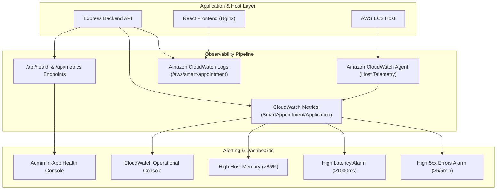

# CloudWatch & Monitoring Architecture Documentation
**Student:** Adarsh Paul . T (Registration No.: 24MIS0564)  
**Subject:** Agile Development Process and DevOps  
**Project:** Smart Appointment Optimization & No-Show Prevention Platform  
**Cloud Region:** AWS `ap-south-2` (Hyderabad)  

---

## 1. Executive Summary & Observability Overview

In modern Cloud DevOps and Site Reliability Engineering (SRE), software is not considered complete until it is fully observable in production. This platform implements the **Three Pillars of Observability**:



---

## 2. CloudWatch Metrics Inventory

Custom application metrics are published under the namespace **`SmartAppointment/Application`**:

| Metric Name | Unit | Aggregation | Dimensions | Purpose |
| :--- | :--- | :--- | :--- | :--- |
| `AppointmentsBooked` | Count | Sum | `ServiceType` | Measures booking demand and velocity |
| `AppointmentsConfirmed` | Count | Sum | None | Tracks proactive customer attendance confirmations |
| `AppointmentsCancelled` | Count | Sum | `Reason` | Monitors cancellation frequency & slot release events |
| `HighRiskAppointmentDetected` | Count | Sum | None | Tracks appointments flagged with no-show score > 60 |
| `RiskScoreCalculated` | None | Average | None | Monitors distribution of rule-based risk scores (0–100) |
| `ApiLatency` | Milliseconds | Average / p95 | `Route`, `Method` | Evaluates API responsiveness against Service Level Objectives (SLO) |
| `Http5xxErrors` | Count | Sum | `Route` | Detects backend server failures and unhandled exceptions |

Host system metrics are collected by the **Amazon CloudWatch Agent** under **`SmartAppointment/System`**:
- `cpu_usage_idle`, `cpu_usage_user`, `cpu_usage_system` (CPU utilization)
- `mem_used_percent`, `mem_available` (RAM utilization)
- `disk_used_percent` (Storage capacity)

---

## 3. CloudWatch Log Groups & Streams

| Log Group | Stream Pattern | Contents |
| :--- | :--- | :--- |
| `/aws/smart-appointment/backend` | `{instance_id}-app-runtime` | Structured JSON application events, booking actions, risk evaluations, and error stack traces |
| `/aws/smart-appointment/frontend` | `{instance_id}-nginx-access` | Web server access logs, client IP, HTTP status, and user-agent data |
| `/aws/smart-appointment/frontend-errors`| `{instance_id}-nginx-error` | Nginx reverse-proxy error logs and gateway timeouts |

---

## 4. CloudWatch Alarms & Automated Incident Management

We have configured 3 automated CloudWatch Alarms:

1. **`SmartAppointment-High5xxErrors`**:
   - **Trigger:** $\ge 5$ HTTP 500 errors in a 5-minute evaluation period.
   - **DevOps Action:** Triggers Amazon SNS alert to the DevOps on-call team and flags an emergency in the deployment pipeline.
2. **`SmartAppointment-HighApiLatency`**:
   - **Trigger:** Average latency $> 1000\text{ ms}$ over two consecutive 5-minute periods.
   - **DevOps Action:** Detects database connection exhaustion or high load, alerting engineering to scale resources.
3. **`SmartAppointment-HighMemoryUtilization`**:
   - **Trigger:** Host RAM utilization $> 85\%$.
   - **DevOps Action:** Identifies memory leaks before the Linux OOM killer terminates application containers.

---

## 5. In-App Health and Telemetry Endpoints

- **`GET /api/health`**: Lightweight health probe for AWS Application Load Balancers (ALB) and Docker Healthchecks. Returns HTTP 200 with uptime, database mode, and memory stats.
- **`GET /api/metrics`**: Telemetry summary containing operational counters, appointment counts, and CloudWatch sync status.
- **`GET /api/monitoring/stream`**: Authenticated real-time streaming endpoint consumed by the Admin UI's **CloudWatch & Health** tab.

---

## 6. How to Deploy CloudWatch Tools

### On the AWS EC2 Instance:
```bash
# 1. Run the automated CloudWatch Agent installer
bash scripts/setup-cloudwatch-agent.sh

# 2. Provision CloudWatch Alarms and Operational Dashboard
bash scripts/setup-cloudwatch-alarms.sh
```

### In Local / Classroom Development Mode:
The platform includes an intelligent **Telemetry Buffer Fallback**. When AWS credentials are not configured or are awaiting verification, all metrics and log streams are captured in-memory and rendered live in the Admin Web Interface so that you can demonstrate observability without incurring AWS charges.
